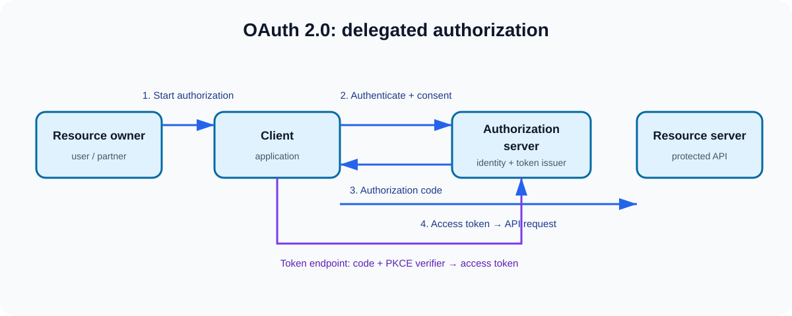

# OAuth 2.0 & Token Security: Q1–Q5

This set focuses on the distinction interviewers probe most often: identity,
delegated authorization, client type, token proof, and resource-server trust.

Each answer has four layers:

- **Interview-ready answer** — a concise response to lead with.
- **Architecture detail** — enough precision for a deep follow-up.
- **Principal Architect lens** — operational and risk decisions.
- **Practice** — questions and a scenario to rehearse.

| # | Question |
| --- | --- |
| 1 | [What is OAuth 2.0 and what problem does it solve?](q1-oauth2.md) |
| 2 | [Which OAuth 2.0 grants should I use and when?](q2-grant-types.md) |
| 3 | [What is PKCE and why is it required?](q3-pkce.md) |
| 4 | [What is the difference between OAuth 2.0 and OIDC?](q4-oidc.md) |
| 5 | [How are JWTs structured and validated?](q5-jwt-validation.md) |

## Diagrams

All assets are repository-local, vector SVGs. They are readable in GitHub,
print cleanly, and can be reused in study notes.
