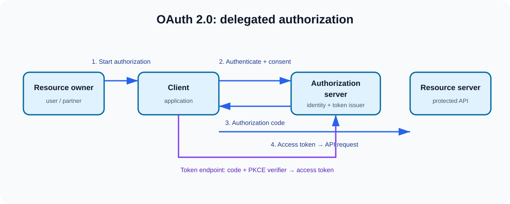

# Q1. What is OAuth 2.0 and what problem does it solve?

## Interview-ready answer

OAuth 2.0 is a delegated authorization framework. It lets a client obtain
limited, time-bounded access to protected resources without collecting or
storing the resource owner's password. Instead of sharing credentials, the
resource owner authorizes a client through an authorization server; the client
receives an access token with constrained scope and uses it at the resource
server.

In an enterprise, I centralize identity, consent, token issuance, key
management, and audit in the authorization server. I distribute enforcement:
the API gateway can perform coarse checks, but every resource server remains
responsible for validating the token and enforcing resource-level policy. That
keeps authorization close to the data and avoids treating the internal network
as trusted.

OAuth is authorization, not a standardized login protocol. For a user login
and identity assertion, I use OpenID Connect on top of OAuth 2.0.

## The problem it solves

Before OAuth, a third-party application often had to collect a user's password
to call another service on their behalf. That creates an all-or-nothing,
hard-to-revoke credential-sharing problem. OAuth replaces it with:

| Problem | OAuth control |
| --- | --- |
| Credential sharing | The client receives a token, not the user's password. |
| Excessive access | Scopes limit the intended operations, such as `orders:read`. |
| Long-lived access | Short token lifetime limits the compromise window. |
| Coarse revocation | Grants and refresh tokens can be revoked without resetting the user's password. |
| Unclear accountability | Client identity, consent, token issuance, and API use are auditable. |

## The four roles

| Role | Responsibility | Example |
| --- | --- | --- |
| Resource owner | Can grant access to a protected resource. | An employee or external partner. |
| Client | Requests delegated access. | A partner portal or mobile app. |
| Authorization server | Authenticates/obtains authorization and issues tokens. | A corporate identity platform. |
| Resource server | Hosts the protected API and enforces access. | Orders, payments, or customer API. |

## Authorization Code flow at a glance

1. The client redirects the user's browser to the authorization endpoint with
   its client ID, exact redirect URI, requested scopes, state, and PKCE
   challenge.
2. The authorization server authenticates the user and collects consent where
   appropriate.
3. It redirects back with a short-lived, one-time authorization code.
4. The client sends the code and PKCE verifier to the token endpoint.
5. The authorization server issues an access token (and, when justified, a
   refresh token).
6. The client presents the access token to the resource server, which validates
   it and then enforces scopes plus domain-specific authorization.

An access token is a credential. A valid token is not automatically sufficient
for every request: a payment API should still decide whether this subject may
perform this action on this account, at this time.

## Principal Architect lens

### Enterprise reference design

- Use a dedicated, highly available authorization server rather than allowing
  each microservice to mint tokens.
- Use OAuth Authorization Code with PKCE for browser, SPA, mobile, and native
  user-facing clients; use Client Credentials for service identities.
- Prefer short-lived, audience-restricted access tokens. Use refresh-token
  rotation and reuse detection where refresh tokens are issued.
- Make redirect URIs exact-match allowlisted. Validate `state` to bind the
  response to the initiating browser session.
- Use asymmetric signing plus JWKS for distributed JWT verification, or opaque
  tokens/introspection when immediate centralized revocation is the dominant
  requirement.
- Apply least privilege at every layer: requested scope, issued scope, gateway
  policy, service policy, and resource-level policy.
- Monitor token issuance, failed client authentication, consent anomalies,
  invalid-token failures, scope denials, and privileged actions.

### Architecture trade-offs

| Decision | Benefit | Cost / mitigation |
| --- | --- | --- |
| Self-contained JWT access token | Local validation, low latency | Revocation is harder; keep lifetime short and plan key compromise response. |
| Opaque access token + introspection | Centralized active/revoked decision | Adds latency and an authorization-server dependency; cache carefully. |
| Gateway-only validation | Simple edge control | Insufficient by itself; services must protect their own resources. |
| Broad scopes | Easier onboarding | Increases blast radius; use granular, API-owned scope vocabulary. |

## A concise scenario answer

**Scenario:** 20 external partners need different permissions across 100
microservices.

I would register each partner client with strongly authenticated credentials,
bounded redirect URIs, and a per-partner scope allowlist. A central
authorization server would issue short-lived tokens with partner, subject,
audience, and scope context. The gateway would reject malformed or broadly
invalid traffic and apply rate limits; each resource server would validate the
token and enforce tenant, ownership, and action-level policy. Keys would rotate
through JWKS with overlapping validation keys. I would revoke grants and refresh
tokens on offboarding, keep access tokens short-lived, and centralize security
events in the SIEM.

## Follow-up questions

1. Why is OAuth 2.0 not itself authentication?
2. What makes a scope model maintainable across many APIs?
3. When would you choose opaque tokens rather than JWT access tokens?
4. Why is an API gateway not a replacement for service authorization?
5. How would you respond if a client secret or signing key were compromised?

## References

- [RFC 6749 — OAuth 2.0 framework](https://www.rfc-editor.org/rfc/rfc6749)
- [RFC 9700 — OAuth 2.0 Security BCP](https://www.rfc-editor.org/rfc/rfc9700)
