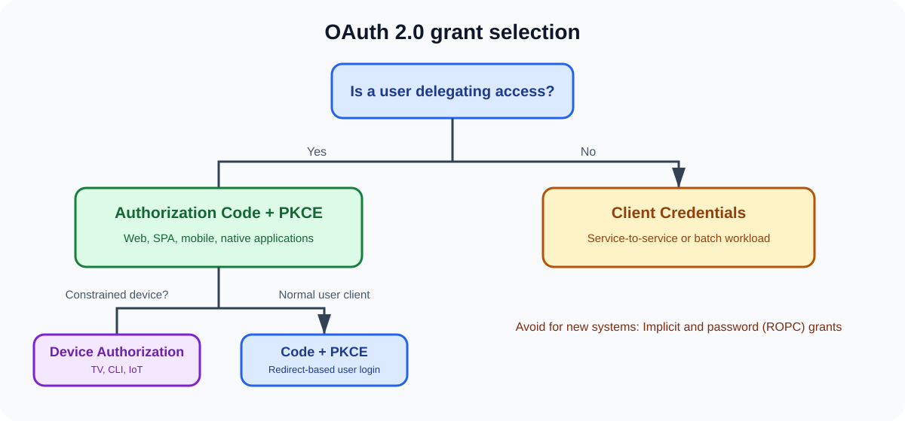

# Q2. Walk me through the OAuth 2.0 grants and when to use each.

## Interview-ready answer

I select the flow based on whether a user is involved, the client type, and
the available trust boundary. For user-facing web, SPA, mobile, and native
applications, I use **Authorization Code with PKCE**. For a workload acting as
itself, I use **Client Credentials** with a managed workload identity, mTLS,
or another strong client-authentication method. For devices without a useful
browser or input path, I use the **Device Authorization Grant**. I do not
design new systems around Implicit or Resource Owner Password Credentials:
they create avoidable exposure and modern security guidance steers clients to
the code flow with PKCE.

The grant type is only the first decision. I still require precise audiences,
minimal scopes, short-lived access tokens, secure client authentication,
refresh-token rotation where relevant, and resource-server enforcement.

## Selection table

| Flow | User present? | Typical client | Use it when | Principal concerns |
| --- | --- | --- | --- | --- |
| Authorization Code + PKCE | Yes | Web, SPA, native, mobile | An application acts for a user. | Exact redirects, `state`, PKCE, refresh rotation. |
| Client Credentials | No | Backend/service/job | A workload acts as itself. | Strong workload identity, narrow scope and audience. |
| Device Authorization | Yes, on another device | TV, CLI, IoT | The device cannot conveniently run an interactive browser login. | Code expiry, phishing resistance, polling limits. |
| Refresh Token | Usually indirect | Previously authorized client | A client needs a new access token without repeating login. | Rotation, reuse detection, secure storage. |
| ROPC / password grant | Yes | Legacy only | A tightly controlled migration exception. | Client handles password; avoid in new design. |
| Implicit | Yes | Historical browser app | Do not use for new designs. | Tokens in browser redirect response; use code + PKCE. |

## 1. Authorization Code with PKCE

The client sends an authorization request in the browser. After authentication
and authorization, it receives a short-lived code. It redeems that code at the
token endpoint, proving possession of the PKCE verifier. The code is less
useful to an interceptor because it is single-use and cannot be redeemed
without the verifier.

Use this flow for public and confidential clients when a user is involved. A
server-side web client may additionally authenticate at the token endpoint, but
that does not remove the value of PKCE.

## 2. Client Credentials

There is no resource-owner delegation: the client itself is the subject. A
batch job, order service, or CI deployment system authenticates to the token
endpoint and obtains an access token for its own permitted operations.

Do not model a background service as a user. Give it a distinct client/service
identity, an API-specific audience, and scopes such as `inventory.read` rather
than broad administrator access. Prefer short-lived, renewable credentials
from the runtime platform over long-lived secrets copied into deployments.

## 3. Device Authorization Grant

1. The constrained device requests a device code.
2. It shows the user a verification URI and short user code.
3. The user completes authentication and consent on a separate capable device.
4. The constrained device polls at the instructed interval until the
   authorization server returns a token or the code expires.

Use it for smart TVs, CLIs, and similar environments. Defend against phishing
by presenting a clear verification domain, expiring codes quickly, rate
limiting attempts, and requiring the user to confirm the code on the
authorization-server page.

## 4. What not to choose for a new system

### Resource Owner Password Credentials (ROPC)

The client collects the user's password and exchanges it for a token. This
defeats federation and many MFA experiences, expands the password-handling
surface, and makes credential phishing easier. It may appear during a legacy
migration, but needs an explicit retirement plan and compensating controls.

### Implicit grant

The access token is returned directly through the browser-mediated response.
Modern applications use Authorization Code with PKCE instead, keeping the
access token out of that front-channel response and adding proof that the
redeeming client initiated the request.

## Principal Architect decision rules

- Treat client type, deployment architecture, and data sensitivity as inputs;
  do not choose a grant because a library's sample happens to use it.
- Never issue a client secret to a browser or mobile application; it cannot
  remain confidential there.
- Do not let a human-user token become a general service-to-service credential.
- Require audience restriction so a token for Orders is not accepted by
  Payments.
- Separate environment clients and scopes. A production token must not work in
  a test API, and vice versa.
- Make refresh-token issuance deliberate: some flows and clients do not need
  one, and every refresh token is a long-lived high-value credential.

## Practice scenario

Choose a flow for each and explain the control that matters most:

| Client | Recommended approach | Why |
| --- | --- | --- |
| React SPA | Authorization Code + PKCE | It is a public client; it needs browser login but cannot protect a secret. |
| Android app | Authorization Code + PKCE using claimed HTTPS/app redirect | Native public client; PKCE protects code redemption. |
| Order service calling inventory | Client Credentials | Machine identity, no user delegation. |
| Smart TV | Device Authorization | Authenticate on a separate device. |
| External partner batch integration | Client Credentials with strong client auth | Partner workload identity and constrained scopes. |

## Follow-up questions

1. Can Client Credentials express a user's consent? Why not?
2. Why is a client secret not an adequate credential for a SPA?
3. How would you rotate service credentials across 100 microservices?
4. What is the security benefit of an exact redirect URI match?
5. When would you issue a refresh token to a public client?

## References

- [RFC 6749 — grant framework](https://www.rfc-editor.org/rfc/rfc6749)
- [RFC 8628 — Device Authorization Grant](https://www.rfc-editor.org/rfc/rfc8628)
- [RFC 9700 — current OAuth security guidance](https://www.rfc-editor.org/rfc/rfc9700)
