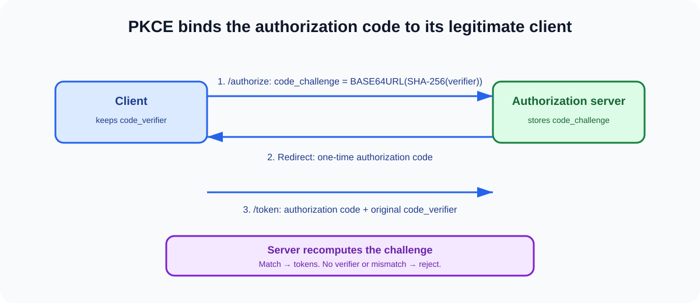

# Q3. What is PKCE and why is it required?



## Interview-ready answer

PKCE—Proof Key for Code Exchange—binds an authorization request to the token
request that redeems its authorization code. The client generates a high-
entropy `code_verifier`, derives a `code_challenge`—normally
`BASE64URL(SHA-256(code_verifier))`—and sends only the challenge in the
front-channel authorization request. When redeeming the code, it supplies the
original verifier. The authorization server recomputes the challenge and only
issues tokens when it matches.

That prevents an intercepted authorization code from being useful to an
attacker who does not have the verifier. It was created for public clients,
but current best practice is to use it for all Authorization Code flows. PKCE
is not a replacement for exact redirect URI validation, `state`, TLS, or
secure token storage; it addresses a specific code-interception and code-
injection class of attacks.

## Protocol sequence

1. Generate a cryptographically random verifier, 43–128 characters from the
   RFC 7636 unreserved character set.
2. Derive `code_challenge = BASE64URL-ENCODE(SHA256(code_verifier))` and use
   `code_challenge_method=S256`.
3. Store the verifier only in the legitimate client transaction/session.
4. Send the challenge with the authorization request; never send the verifier
   in that request.
5. Receive a short-lived, single-use authorization code at the registered
   redirect URI.
6. Send the code plus original verifier to the token endpoint.
7. The server compares the derived challenge to the one bound to that code.
   It issues tokens only if they match.

```text
code_verifier  --SHA-256 + Base64URL-->  code_challenge
     |                                         |
 kept by client                           sent with /authorize
     |                                         |
     +------- sent only to /token -----------> Authorization Server
```

## What PKCE prevents—and what it does not

| Threat | PKCE effect |
| --- | --- |
| Attacker intercepts an authorization code | Cannot redeem it without the verifier. |
| Malicious app tries to redeem a native-app callback code | Cannot prove possession of the original verifier. |
| Leaked access token | No protection; the token is still a bearer credential unless sender-constrained. |
| Redirect URI manipulation | No protection; enforce pre-registered exact redirects. |
| Login CSRF / response mix-up | No protection by itself; validate `state` and issuer/response binding. |
| XSS in the legitimate SPA | Limited protection; XSS can access client state, so prevent XSS and use a sound token model. |

## Why it matters to an architect

The old distinction—"PKCE is only for mobile"—is not a safe design rule.
Browser-based and native applications are public clients, and even a
confidential web client benefits from binding its authorization request to the
code exchange. The operational price is negligible because established OAuth
libraries support it.

My baseline policy is:

- Require `S256`; do not allow the weaker `plain` method unless an exceptional
  compatibility requirement is explicitly risk accepted.
- Make PKCE mandatory at the authorization server for every code-flow client.
- Reject missing, malformed, expired, reused, or mismatched authorization
  codes and record security telemetry without logging secrets.
- Use cryptographically secure randomness; never derive a verifier from user
  IDs, timestamps, or a predictable PRNG.
- Keep codes short-lived and single-use, even with PKCE.
- Pair PKCE with `state` for request/response correlation and with OIDC nonce
  validation when an ID Token is requested.

## Implementation review checklist

- [ ] Uses `S256`, not `plain`.
- [ ] Generates 43–128 character verifier using a CSPRNG.
- [ ] Persists verifier only for the active authorization transaction.
- [ ] Requires PKCE on the authorization server.
- [ ] Enforces exact registered redirect URI matching.
- [ ] Validates `state`; validates OIDC `nonce` where applicable.
- [ ] Does not log verifier, code, access token, refresh token, or callback URL
  query string containing credentials.
- [ ] Uses a maintained OAuth/OIDC library rather than handwritten protocol
  parsing.

## Practice scenario

**Question:** A malicious application registers the same custom URI scheme as
your mobile app and receives an intercepted authorization code. Why does PKCE
prevent account takeover?

**Answer:** The attacker may receive the redirect containing the code, but the
authorization server bound that code to a challenge created by the legitimate
app. The attacker does not possess the legitimate app's verifier, so its token
request cannot satisfy the challenge comparison. The code must also be
single-use and short-lived. I would still prefer claimed HTTPS redirects or
platform app/universal links where possible and enforce exact redirect URI
registration to reduce interception opportunities.

## Follow-up questions

1. Why is `S256` preferable to `plain`?
2. Does PKCE authenticate a public client?
3. How are `state` and OIDC `nonce` different from PKCE?
4. What happens when a code is used twice?
5. Can PKCE prevent refresh-token theft?

## References

- [RFC 7636 — PKCE](https://www.rfc-editor.org/rfc/rfc7636)
- [RFC 9700 — OAuth 2.0 Security BCP](https://www.rfc-editor.org/rfc/rfc9700)
