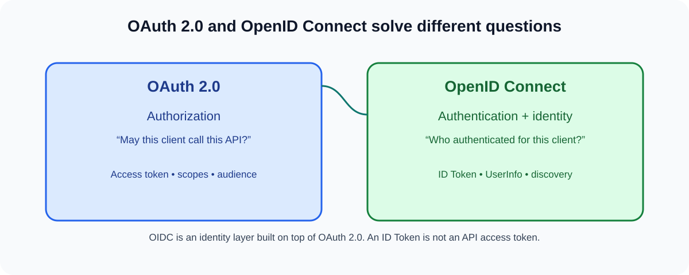

# Q4. What is the difference between OAuth 2.0 and OpenID Connect?



## Interview-ready answer

OAuth 2.0 answers an authorization question: *what access has been delegated
to this client for a resource?* OpenID Connect (OIDC) adds a standardized
identity layer on top of OAuth 2.0 and answers: *who authenticated, through
which issuer, for this relying party?*

For sign-in and SSO, I use OIDC. The client requests the `openid` scope and,
after a suitable flow such as Authorization Code with PKCE, receives an ID
Token containing a signed identity assertion. The relying party validates the
ID Token before establishing its own session. It may use an access token to
call UserInfo or an API, but an access token is not a substitute for validating
an ID Token, and an ID Token is not a credential for calling APIs.

## Comparison

| Concern | OAuth 2.0 | OpenID Connect |
| --- | --- | --- |
| Primary purpose | Delegated authorization | Authentication and interoperable identity on OAuth 2.0 |
| Main artifact | Access token | ID Token, plus OAuth artifacts |
| Client question answered | “May I call this API?” | “Who authenticated and is this response for me?” |
| Typical use | API access, service-to-service | SSO and “Sign in with…” |
| Standard user identity claims | Not defined by OAuth alone | Defines `sub`, `iss`, `aud`, `nonce`, and standard profile claims |
| Discovery | OAuth metadata may be used | Standard provider discovery includes OIDC metadata |

## What OIDC adds

### ID Token

An ID Token is a JWT carrying claims about an authentication event. Typical
claims include:

```json
{
  "iss": "https://id.example.com",
  "sub": "00u123abc",
  "aud": "partner-portal-web",
  "exp": 1893459600,
  "iat": 1893456000,
  "nonce": "client-generated-value",
  "acr": "urn:example:loa:2"
}
```

The stable identity key is usually the pair `(iss, sub)`, not an email address:
email can change and may not be globally unique. `acr` and `amr` can express
authentication assurance and methods when the application's risk model needs
them.

### UserInfo endpoint

The client can retrieve additional claims at the UserInfo endpoint using an
access token. Treat the response as security-sensitive: validate that it is
associated with the expected subject and obtain it only over TLS from the
discovered provider endpoint.

### Discovery and registration metadata

OIDC Discovery exposes configuration at:

```text
https://issuer.example.com/.well-known/openid-configuration
```

It names the issuer, authorization endpoint, token endpoint, JWKS URI,
supported algorithms, and other interoperable metadata. Pin the expected
issuer through trusted configuration; do not let an arbitrary request choose a
discovery URL.

## ID Token validation checklist

Before creating a local session, the relying party should at minimum:

1. Verify the JWS signature using trusted issuer keys and an explicit allowed
   algorithm set.
2. Require exact issuer (`iss`) match to the configured/discovered issuer.
3. Check that `aud` contains this client ID; check `azp` when required by the
   token's audience arrangement.
4. Validate `exp` and `iat`, with only a small justified clock skew.
5. Verify the `nonce` equals the value bound to the browser authentication
   transaction when one was sent.
6. Validate `c_hash`/`at_hash` when the response type and OIDC rules require
   it.
7. Validate `state` separately; it protects the authorization response
   correlation and is not replaced by `nonce`.

## Principal Architect lens

- Centralize workforce, partner, and customer authentication at an IdP where
  appropriate, while allowing applications to retain their domain-specific
  authorization decisions.
- Support both OIDC and SAML during enterprise transitions, but choose OIDC
  for new web, mobile, and API-friendly integrations unless a partner requires
  SAML.
- Model assurance explicitly for sensitive actions. A successful session alone
  may not be enough; require recent authentication, a suitable `acr`, or step
  up MFA.
- Keep ID Tokens out of API authorization paths. APIs receive access tokens
  whose audience and scopes are for those APIs.
- Design logout intentionally. Front-channel logout is best effort; use
  provider-supported back-channel logout/session management and local session
  expiry according to risk.

## Practice scenario

**Question:** The front end receives both an ID Token and an access token. Can
it send the ID Token to the Orders API as a bearer token?

**Answer:** No. The ID Token's audience is the client application and its job
is to prove an authentication event to that client. The Orders API must accept
an access token issued for the Orders audience and validate authorization
claims appropriate to the API. Conflating them invites audience confusion and
authorization bugs.

## Follow-up questions

1. Why is `(iss, sub)` a better application identifier than email?
2. What is the difference between `state` and `nonce`?
3. When do you need to validate `azp`?
4. How do you support SSO across independently deployed applications?
5. Why should an API reject an ID Token?

## References

- [OpenID Connect Core 1.0](https://openid.net/specs/openid-connect-core-1_0.html)
- [OpenID Connect Discovery 1.0](https://openid.net/specs/openid-connect-discovery-1_0.html)
