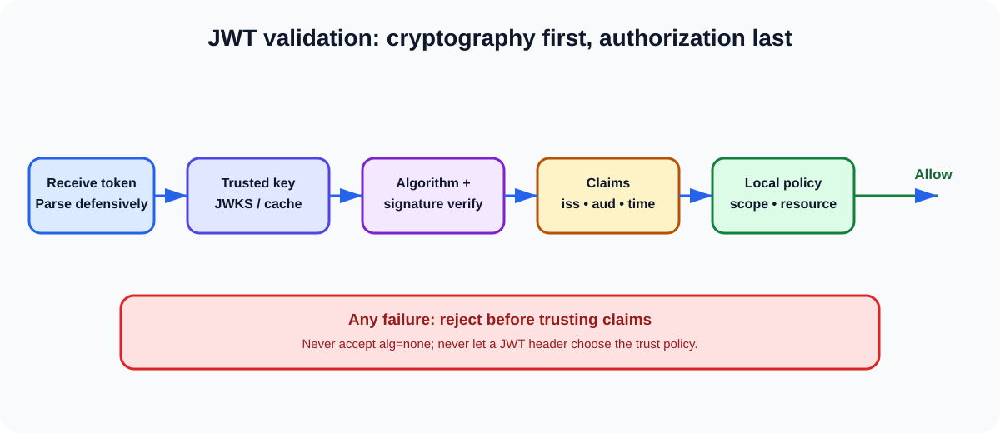

# Q5. Explain JWT structure and validation.



## Interview-ready answer

A JSON Web Token is a compact claims format. A commonly seen signed JWT—more
precisely, a compact JWS—has three Base64URL-encoded segments:
`header.payload.signature`. The header identifies information such as the
signing algorithm and key ID; the payload carries claims; the signature proves
integrity and issuer control of the signing key.

Decoding a JWT is not validation. A resource server must first verify its
signature with a trusted key and an explicit algorithm allowlist, then validate
issuer, audience, lifetime, and token-specific claims before using the claims
for authorization. In a distributed system, I prefer asymmetric signing with
issuer-published JWKS, cache keys safely, rotate with overlapping keys, and
design for revocation and key compromise rather than assuming that a signature
alone solves the lifecycle problem.

## Structure

```text
BASE64URL(header).BASE64URL(payload).BASE64URL(signature)
```

```json
// protected header
{ "typ": "JWT", "alg": "RS256", "kid": "2026-04" }

// payload / claims
{
  "iss": "https://id.example.com",
  "sub": "user-123",
  "aud": "orders-api",
  "exp": 1893459600,
  "nbf": 1893456000,
  "iat": 1893456000,
  "jti": "c0f1...",
  "scope": "orders.read"
}
```

Base64URL is an encoding, not encryption. Do not put passwords, secrets, or
unnecessary sensitive personal data into a normally signed JWT. If
confidentiality is required, choose an appropriate encrypted-token design (JWE)
and still manage the complexity carefully.

## Claim meaning

| Claim | Validation purpose |
| --- | --- |
| `iss` | Exact expected issuer. |
| `sub` | Subject identifier; meaningful in the issuer's namespace. |
| `aud` | Intended recipient(s); must include this resource server/client as applicable. |
| `exp` | Latest time token is accepted. |
| `nbf` | Earliest time token is accepted. |
| `iat` | Issued-at context; reject impossible/future values according to policy. |
| `jti` | Identifier useful for replay detection or deny-list lookup. |
| `kid` | Header key identifier used to select a trusted verification key. |

## Mandatory validation pipeline

1. **Parse defensively.** Impose token/header/payload size limits and reject
   malformed or unsupported JWTs before expensive work.
2. **Select a trusted key.** Obtain it from pinned issuer configuration or a
   trusted JWKS cache. `kid` is a lookup hint, not permission to fetch a key
   from an attacker-controlled URL.
3. **Enforce algorithm policy.** Configure allowed algorithms for this issuer
   and key type; do not trust the incoming `alg` to select the policy. Reject
   `none` and prevent HS/RS or other algorithm-confusion paths.
4. **Verify cryptographic signature.** Fail closed if verification fails.
5. **Validate issuer and audience.** Require exact `iss` and a correct `aud`
   for the current service—not merely any token from the same identity provider.
6. **Validate temporal claims.** Enforce `exp`, `nbf`, and sensible `iat`
   behavior with a small, measured clock-skew allowance.
7. **Apply profile-specific checks.** For an OIDC ID Token, validate nonce and
   other OIDC-required values. For sender-constrained tokens, validate the
   binding. For replay-sensitive operations, apply `jti`/proof/replay policy.
8. **Authorize locally.** Check scope, roles/permissions, tenant, ownership,
   and business constraints. Authentication/token validity is not authorization.

## JWKS and key rotation

For asymmetric algorithms such as RS256 or ES256, the issuer keeps private
signing keys and publishes public keys through a JWKS endpoint. The token's
`kid` selects a public key in the trusted key set.

- Cache JWKS with bounded TTL and respect cache metadata.
- On an unknown `kid`, refresh once with rate limiting and then fail closed.
- During planned rotation, publish the new key before using it and retain the
  old public key until all tokens signed by it should have expired.
- Protect signing keys in HSM/KMS-backed systems with restricted access,
  auditing, and a tested emergency rotation path.
- Do not make every API request dependent on a live JWKS endpoint; cached,
  previously trusted keys preserve availability during a temporary outage.

## Common failure modes

| Mistake | Consequence | Control |
| --- | --- | --- |
| Accept `alg: none` | Unsigned attacker-created token may be accepted. | Explicit allowlist; maintained library. |
| Algorithm confusion | A key intended for one algorithm is abused for another. | Bind issuer, key type, and exact algorithms in configuration. |
| Skip `aud` check | Token for API A is replayed at API B. | API-specific audience validation. |
| Trust decoded claims first | Attacker-controlled payload becomes authorization input. | Verify before inspecting claims for decisions. |
| Long expiration | Large theft/replay window. | Short-lived access tokens and renewal strategy. |
| Put token in URL | Logs, browser history, and referrers can leak it. | Authorization header or secure back-channel. |
| Cache JWKS forever | Key rotation or compromise response fails. | Bounded caching and refresh strategy. |

## JWT versus opaque tokens

JWTs enable local validation and can scale well across services, but immediate
revocation is difficult once a valid token is in circulation. Opaque tokens
with introspection provide a centralized active/revoked decision but create a
runtime dependency and latency. A common design is short-lived JWT access
tokens plus refresh-token revocation; use introspection, a deny-list, or
sender-constrained tokens for higher-risk operations where the trade-off is
justified.

## Practice scenario: compromised signing key

**Question:** A signing key is compromised. How do you rotate it across 100
resource servers without causing an outage?

**Answer:** I activate an incident plan: stop signing with the compromised key,
generate and protect a replacement key, publish its public JWK, and start
signing new tokens with the new `kid`. Resource servers refresh JWKS on unknown
`kid` within bounded limits and retain previously trusted keys only according
to the incident policy. Because tokens signed by the compromised key may be
forged, normal overlap alone may be unsafe: I shorten/disable acceptance of
that `kid`, revoke affected sessions/refresh tokens, and use introspection or
a propagated deny-list for critical paths until the exposure window is closed.
I monitor validation failures and JWKS refresh health, then complete user and
client reauthentication as the risk assessment requires.

## Follow-up questions

1. Why is RS256/ES256 often preferred to HS256 across independent services?
2. What should happen when a token contains an unknown `kid`?
3. Which validation is different for an ID Token versus an access token?
4. How do you revoke an otherwise valid JWT before `exp`?
5. What telemetry distinguishes attack traffic from a normal key rotation?

## References

- [RFC 7519 — JWT](https://www.rfc-editor.org/rfc/rfc7519)
- [RFC 7517 — JWK/JWKS](https://www.rfc-editor.org/rfc/rfc7517)
- [RFC 8725 — JWT Best Current Practices](https://www.rfc-editor.org/rfc/rfc8725)
- [OpenID Connect Core — ID Token validation](https://openid.net/specs/openid-connect-core-1_0.html)
